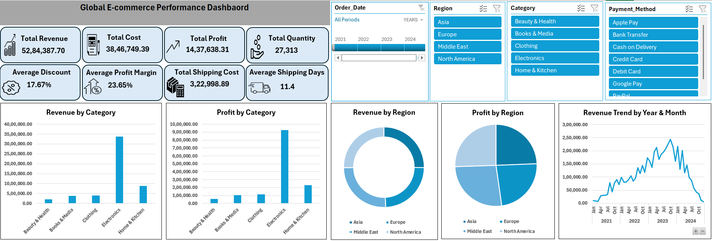

# Global E-commerce Performance Intelligence

## Project Overview

This project is an Excel-based e-commerce sales analysis project. The main aim is to understand sales and business performance using different views of the data.

The project includes data cleaning, analysis, Pivot Tables, charts, KPIs, slicers, and an interactive dashboard.

## Project Objective

The main objectives of this project are:

* Analyze revenue and profit
* Understand category performance
* Compare regional performance
* Analyze payment methods
* Check monthly sales performance
* Create an easy-to-use Excel dashboard

## Tools Used

* Microsoft Excel
* Excel Formulas
* Pivot Tables
* Pivot Charts
* Slicers

## Data Preparation

Before starting the analysis, the data was checked and prepared.

The main steps included:

* Checking blank or missing values
* Checking duplicate records
* Checking data formats
* Checking negative values
* Checking percentage and currency formats

## Analysis

The project includes analysis of:

* Revenue by Category
* Profit by Category
* Revenue by Region
* Profit by Region
* Quantity by Category
* Revenue by Payment Method
* Monthly Revenue

## Dashboard

The Excel dashboard provides a simple view of the main results.

It includes:

* KPI cards
* Charts
* Slicers
* Category analysis
* Regional analysis
* Payment method analysis
* Monthly sales analysis

Slicers can be used to filter the data and view the required information.

## Key Insights

The analysis helps to understand:

* Revenue and profit by category
* Revenue and profit by region
* Payment method usage
* Monthly sales trends
* Effect of discounts on profit

## Project Files

* `Global_Ecommerce_Performance_Intelligence.xlsx` – Main Excel dashboard and analysis
* `Documentation` – Project documentation

## Conclusion

This project helped me improve my practical Excel skills. It gave me experience in data cleaning, Pivot Tables, charts, slicers, and dashboard creation.

It also helped me understand how Excel can be used to analyze sales data and present the results in a simple way.